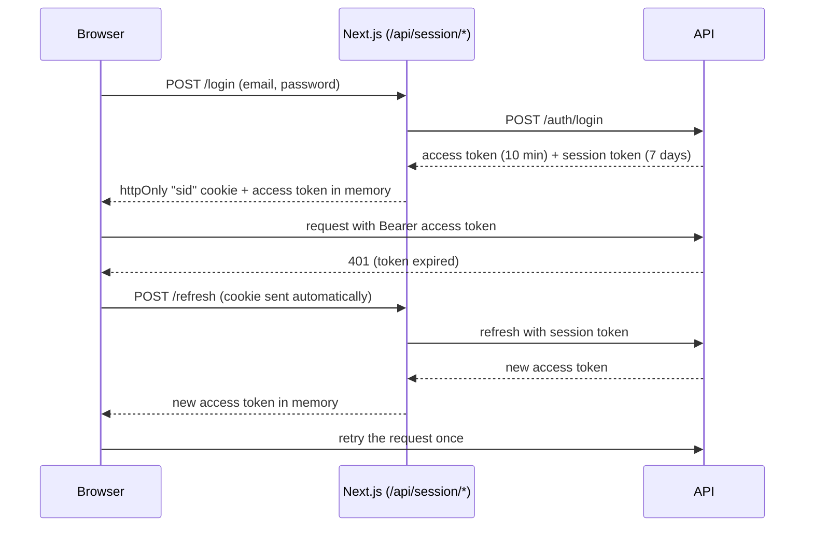

# Doctor Appointment Booking: Web

Patients find a doctor, pick a free slot and book. Doctors manage their schedule. Admins run the clinic catalogue. The whole interface is in French.


**API:** [doctor-appointment-api](../doctor-appointment-api) (Express 5, PostgreSQL, Redis, RabbitMQ)
**Live demo:** TODO

## Features

| Role    | What they can do                                                                                 |
| ------- | ------------------------------------------------------------------------------------------------ |
| Visitor | Browse doctors, clinics and specialties, filter by URL, see free slots                           |
| Patient | Book and cancel appointments, live notifications, edit profile and photo                         |
| Doctor  | See their agenda, manage availability and time off                                               |
| Admin   | Dashboard with daily chart, create doctors (temporary password), clinics, specialties, audit log |

Dark mode, keyboard navigation, skip link, `robots.txt` and `sitemap.xml` are included.

## Stack

Next.js 16 (App Router, Turbopack, typed routes) · TypeScript · Tailwind v4 · shadcn/ui (Radix, Lucide) · TanStack Query and Form · Zod 4 (French error messages) · Zustand · axios · socket.io-client · next-themes · Sonner

Quality: Vitest, Testing Library and MSW · Playwright · ESLint · Prettier · Husky and lint-staged · GitHub Actions · Docker

## Architecture

### Session handling (BFF)

The browser never stores a long-lived token where JavaScript can read it.



- The access token lives in a Zustand store (memory only). The session token is only in an httpOnly cookie.
- One axios interceptor refreshes on 401 and shares a single in-flight refresh between parallel requests.
- Server code never imports client code. Public catalogue pages are fetched on the server with a separate client and hydrated into TanStack Query.

### Other decisions

- **Clinic time zone.** All slot logic is in Europe/Paris. Helpers convert local date and time to an instant, so a visitor in another zone still sees clinic time.
- **URL as state.** Search, page, specialty and clinic filters live in the query string, so pages are shareable and back/forward works.
- **Form validation.** Zod schemas are shared by forms and API response parsing, with French messages set once.
- **Role gates.** `proxy.ts` handles cheap redirects; `RoleGate` enforces roles in the UI. The API remains the authority.

## Quick start

Requires Node 24, pnpm, and the API running on port 3000.

```bash
pnpm install
cp .env.example .env.local   # then fill in the values
pnpm dev                     # http://localhost:5173
```

## Scripts

| Command                                        | Purpose                                  |
| ---------------------------------------------- | ---------------------------------------- |
| `pnpm dev`                                     | Dev server on port 5173                  |
| `pnpm build`                                   | Production build                         |
| `pnpm lint` / `pnpm typecheck` / `pnpm format` | Static checks                            |
| `pnpm test`                                    | Unit and integration tests (Vitest, MSW) |
| `pnpm e2e`                                     | Playwright against a running API         |

## Testing

- **Unit and integration (Vitest).** Forms, helpers and the booking flow run against MSW. Any unmocked request fails the test.
- **End to end (Playwright).** Public pages, sign-in, role gates, the admin portal, and booking then cancelling an appointment against the real API.

```bash
cp .env.e2e.example .env.e2e   # fill in three test accounts and a doctor id
pnpm e2e
```

Start the API with `RATE_LIMIT_DISABLED=true` in its `.env` for local E2E runs, or the login limiter will block the suite.

## Docker

```bash
docker compose up --build   # http://localhost:5173
```

`NEXT_PUBLIC_*` values are baked into the bundle at build time, so changing the API or site URL needs a rebuild.

## CI

GitHub Actions runs Prettier, ESLint, tests, build and typecheck on every push, then builds the Docker image and publishes it to GHCR from `main`. The E2E job is gated behind the `RUN_E2E` variable.

## Project layout

```
src/app/          routes: (public), (auth), (app) with patient, doctor and admin areas
src/features/     one folder per domain: booking, appointments, admin, profile, ...
src/lib/api/      axios clients, Zod schemas, session refresh
src/components/   shared UI
tests/            MSW server, fixtures, render helper
e2e/              Playwright specs
```
